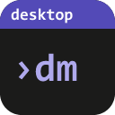
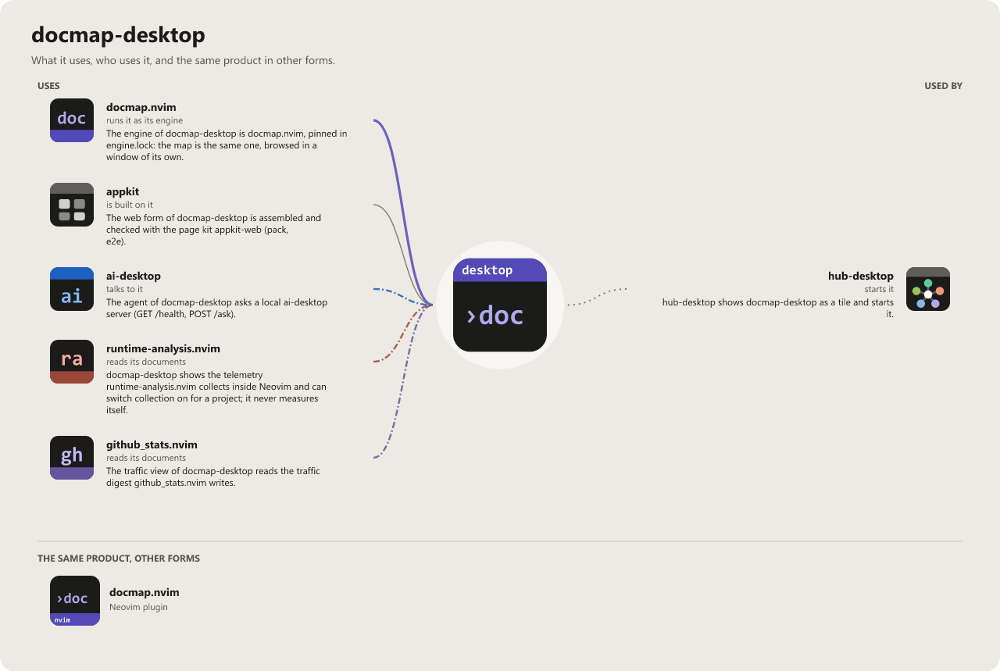

```
     _                                    _           _    _
  __| |___  __ _ __  __ _ _ __   _____ __| |___  ___ | |__| |_ ___ _ __
 / _` / _ \/ _| '  \/ _` | '_ \ |___ / _` / -_)(_-< | / /|  _/ _ \ '_ \
 \__,_\___/\__|_|_|_\__,_| .__/    |_\__,_\___|/__/ |_\_\ \__\___/ .__/
                         |_|                                     |_|
```

[](https://wkdsteve.github.io/wkd/apps/docmap-desktop/)

> **know your project**

A desktop workspace for the module maps [docmap.nvim](https://github.com/WKDSteve/docmap.nvim)
generates: add several projects, look at any of them, switch between them
quickly. The kind of shell an IDE or Blender put in front of a
project — a list you load from, not one window per thing.

**Status: beta.** In use and released in versions (newest: v0.6.0); the surface is not frozen yet.

**This is not a Neovim plugin and does not need Neovim.** It is a separate
program, in a separate repository, with a separate toolchain — deliberately.

Three repositories, one triangle. `docmap.nvim` is the Neovim plugin
this app's engine is extracted from — the map is identical, browsed with or
without a window. [`runtime-analysis.nvim`](https://github.com/WKDSteve/runtime-analysis.nvim)
is `docmap.nvim`'s own sibling plugin, extending it with a live half
neither `docmap.nvim` nor this app can produce alone: call-count
telemetry, collected only while real code runs inside a Neovim session. This
app is the third leg — the same static map always, and the same live
Telemetry/Loaded panels too, whenever a Neovim session collected the data
for that project.

## Table of content

- [Get the app](#get-the-app)
- [In the browser, without installing](#in-the-browser-without-installing)
- [Why this exists as its own program](#why-this-exists-as-its-own-program)
- [What already exists, and what this adds](#what-already-exists-and-what-this-adds)
- [Status](#status)
- [Documentation](#documentation)
- [Build](#build)

## Get the app

Releases carry **a Windows installer only** (`-setup.exe`, installed per user, no Rust toolchain required); there is no
macOS or Linux package. Built by [`.github/workflows/release.yml`](.github/workflows/release.yml) from a
pushed `vX.Y.Z` tag on the self-hosted Windows runner of the author, by choice (pull requests are checked on
GitHub-hosted runners); see [Build](#build) below to build one yourself
instead. [Download the latest release](https://github.com/WKDSteve/docmap-desktop/releases/latest).

**Or install it with a script** — for the current user, no administrator rights, and
nothing for SmartScreen to stop (a file the script downloads carries no
"from the internet" mark; the script checks it against `SHA256SUMS` instead and
runs nothing that does not match). In your own PowerShell, not elevated:

```powershell
# the newest state of main (the pre-release "latest", Windows x86-64)
powershell -ExecutionPolicy Bypass -c "irm https://github.com/WKDSteve/docmap-desktop/releases/download/latest/install.ps1 | iex"

# a release: the same with the tag in place of latest, e.g. .../releases/download/v0.6.0/install.ps1
```

The script of a release installs exactly that release, the script of `latest`
the rolling build ([`rolling.yml`](.github/workflows/rolling.yml), rebuilt after
every green CI run on `main`, for trying what is new). It runs the NSIS
setup silently. The script is the one of appkit's
[release-kit](https://github.com/WKDSteve/appkit/tree/main/release-kit), stamped
for this app and the channel when it is attached. This route is written from the script's documented
behaviour and the workflow's own check; the anonymous download has not been tried by hand yet.

**Or build this checkout and install it** (Windows; Rust and the Tauri CLI, see [Build](#build)):
the engine is staged the way the rolling build does it (`standalone-latest` of docmap.nvim, once,
`-RefreshEngine` fetches it again), `cargo tauri build --bundles nsis` makes the setup, and that setup
runs silently for the current user. A file built on the machine carries no mark for SmartScreen to stop.

```
.\scripts\build-install.ps1 [-BuildOnly] [-RefreshEngine]
.\scripts\uninstall.ps1
```

`uninstall.ps1` runs the uninstaller of the installation silently, whichever way it came (this script, the
setup or the install line: all three are the same per-user setup); your settings and projects stay.

You will also need `docmap.nvim`'s standalone engine binary — this
app runs it, it does not replace it. See [The engine](#the-engine).

## In the browser, without installing

For a machine on which nothing may be installed or run there is the **web variant**: the same window as one HTML
file, `docmap.html`, opened from disk in Chrome or Edge. No program, no server, no request to anywhere; the engine
of docmap.nvim runs inside the page, and a project is a folder you pick in the browser.

```
git clone https://github.com/WKDSteve/docmap-web
```

Open `docmap.html` from that folder (`file:///C:/repos/docmap-web/docmap.html`), choose **Add project…** and pick a
folder. The page reads the folder and writes nothing into it: a map you generate lives in the tab, a map that
already lies in the folder is shown as it is. After a restart of the browser one click (**Allow access**) lets it
read your folders again.

What it has not, because there is no program behind it: function-level facts in a map generated there (no parser),
the git history, telemetry of a Neovim session, rule runs with an agent, statistics, opening a file in your editor,
cloning from a URL and anything from GitHub. The page says so itself, in the strip under its menu bar.
[docs/WEB.md](docs/WEB.md) has the whole comparison, the limits, what the page can reach, and how it is built.

## Why this exists as its own program

`docmap.nvim` answers "which project am I looking at" the best way
available to it: it resolves the repository from the current buffer, per
invocation. Inside an editor that is not a question a UI should ask, and a
project switcher there would be a second, worse answer to a settled one.

Outside an editor there is nothing to resolve from — which is exactly where a
switcher belongs. That reasoning is recorded in the plugin's own design notes;
this repository is its consequence.

## What already exists, and what this adds

The two expensive halves were built before this repository and are reused
whole, not reimplemented:

| Piece | Where it comes from |
|---|---|
| The analysis | `docmap.nvim`'s standalone build — a single binary that maps an annotated tree with no Neovim and no Lua install, in nine language backends: Lua, JavaScript, TypeScript, TSX, Zig, Java, C, C++ and assembly |
| The view | The generated page itself: self-contained HTML, every tab, no CDN, no build step |
| Cross-project links | `opts.tag_files`, already resolving one project's map against another's |
| Live telemetry (optional) | [`runtime-analysis.nvim`](https://github.com/WKDSteve/runtime-analysis.nvim) — the sibling Neovim plugin whose call-count data feeds the Telemetry and Loaded panels, when a Neovim session collected any for that project |

What this repository adds is the part neither of them can have: a window, a
project picker, and the ability to move between projects without opening a
dozen files. Around that: a menu bar with the commands, a settings dialog,
an interface in English and German, and a mark on any project whose sources
have moved on since its map was built.

And the level above a project. With nothing selected the window lists **every
project in the workspace at once**, ranked by what wants doing — no map yet,
built by an older engine, changed since it was built, fine. A single
repository cannot show that and neither can the picker, which names one
project at a time; on a tree of fifty it is the difference between a question
and fifty answers.

Under it, **what depends on what**. Every map records the modules it required
from outside itself and cannot say where they live, because it never saw
them; several maps together can. Matched against the module names other
projects declare — exactly, not by guesswork — that becomes *this project is
used by five others, in 197 places, and here is what they reach for*. It asks
the engine nothing: the artifacts on disk are the whole input, which is
[`HOSTING.md`'s "the artifact is the extension
point"](https://github.com/WKDSteve/docmap.nvim/blob/main/docs/HOSTING.md)
with its first consumer attached. **View as matrix…** renders the same edges
as a grid instead of a list — rows require columns, a cell is call-site
count — in a dialog of its own, off the default overview, for the workspace
sizes where a list of edges stops being something you can read at a glance.

## Status

Usable. Add projects — from a folder, a URL, or the plugin specs your
Neovim config declares — generate their maps, read them, and move between
them. Point the folder picker at a directory that is not itself a
repository — `$REPOS_DIR` holding thirty-two plugins, say — and a checklist
of what is inside it replaces the single add button. Group them into
**workspaces** and switch between whole sets. Browse
the project's **files as they are on disk**, and open any file, or the line
a function lives on, in your own editor. Export a diagram, switch the theme
and the interface language, see which projects need regenerating and
regenerate exactly those, and file a bug report with the versions already
filled in.

Each project also carries **its own settings** — which languages the engine
reads there, and which paths it leaves out — kept apart from the settings
that belong to this machine, because "my engine lives here" and "this
repository vendors a copy of something" are facts about different things.

**One thing to know before anything else: a generated map is a snapshot of
the engine that wrote it.** The map is an HTML document produced at the
moment you pressed Generate, not something this window renders live — so a
page feature that shipped after your map was written arrives by
*regenerating that project*, not by updating the app or the engine. What
updating the app changes is this window: the sidebar, the menu, the panes,
the settings.

See [docs/USAGE.md](docs/USAGE.md) for what every button does. Where the program
is going, what is being worked on and the design records behind it are the
author's working notes and are kept outside this repository; this one holds what
a user or a contributor needs.

## Documentation

| Document | Covers |
|---|---|
| [docs/FEATURES/](docs/FEATURES/README.md) | The catalogue, by theme: the workspace model, running the engine, the window, settings, and the desktop parts. What it does, with the module behind each — the same shape the Neovim siblings use, so one reader can move between all three repositories. |
| [docs/USAGE.md](docs/USAGE.md) | Using it, button by button: adding projects, workspaces, the project picker and its five sort orders, GitHub traffic, the files pane, opening a file in your editor, the four Generate commands, settings and per-project settings, the notes that appear over some panels, the menu bar, and where everything is stored. |
| [docmap.nvim/docs/ecosystem.md](https://github.com/WKDSteve/docmap.nvim/blob/main/docs/ecosystem.md) | **The architecture, and it is not in this repository.** Where docs, static analysis and runtime each belong, and why `runtime-analysis.nvim` is a separate plugin rather than a module. Written before this app existed, so it describes four pieces and not five — a header there records why that needed a note and not a revision: this app is a second host for the artifact-and-serve tier its Seam B already covers. |
| [docs/WEB.md](docs/WEB.md) | The web variant: one HTML file opened from disk, for a machine that may install nothing. Getting and using it, what differs from the app, its limits, what the page can and cannot reach, how it is built and tested. |
| [docs/RELEASING.md](docs/RELEASING.md) | Cutting a release: what to check before tagging, what the workflow builds, and why the last step is a person opening the app. |

### The engine

Generation runs `docmap.nvim`'s standalone binary — no Neovim and no
Lua install needed on your machine. The app looks for `docmap` on `PATH`
and otherwise lets you point at it; the sidebar says which of the two it
found. Build one with that repository's `scripts/package.lua`.

Pointing the app at a directory of compiled tree-sitter grammars is
optional and changes fidelity, not success: with them you get
function-level data, without them a complete module tree that says so. Not
every backend wants one — assembly is read without a parser at all, and the
engine reports "needs no grammar" and "wanted one, could not find it" as
the different answers they are.

## Build

Requires a Rust toolchain and the Tauri CLI (`cargo install tauri-cli`).
Nothing here is needed by anyone *using* the result: `cargo tauri build`
produces a native executable plus an installer.

```bash
cargo tauri dev      # run it
cargo tauri build    # produce a binary + installer
```

Tauri renders through the operating system's own webview rather than shipping
a browser engine, which is why the result is ~10 MB instead of ~150 MB. That
is the one runtime dependency worth knowing about: WebView2 on Windows
(present on Windows 11 and current Windows 10, and the installer can supply
it), WKWebView on macOS (part of the system), WebKitGTK on Linux (a package
dependency).

### Tests

`cd src-tauri && cargo test` for the Rust side. CI also gates on formatting and
lints on all three platforms; the local mirror of those two steps is

```bash
cd src-tauri
cargo fmt --check
cargo clippy --locked --all-targets -- -D warnings
```

(`cargo fmt` applies the formatting; `newline_style` is pinned to Unix in
`src-tauri/rustfmt.toml`, so a CRLF working copy fails `cargo fmt --check`
locally - CI is safe because `.gitattributes` checks out LF. On Windows use an
LF editor setting or `git config core.autocrlf input`.) The frontend's shared helpers
(`src/lib/*.js`) have their own tests, run with Node's built-in test runner —
no `npm install` involved, on purpose, the same reasoning `src/index.html`
gives for no bundler:

```bash
node --test src/lib/*.test.js
```

The web variant (`web/`) is the one part with a package manager: its tests, its build and its browser tests are
`pnpm test`, `pnpm build` and `pnpm e2e` there ([docs/WEB.md](docs/WEB.md#building-and-testing)).

The real window has test sheets of testing.nvim (`TESTS/sheets/`, engine
`webview`: the page in the WebView2, through tauri-driver and msedgedriver).
`.testing.lua` builds the release binary and starts it against folders of the
run, never your own: `DOCMAP_DESKTOP_CONFIG_DIR` (an absolute path; a
relative one is refused) moves the app's config directory (projects,
workspaces, clones), `WEBVIEW2_USER_DATA_FOLDER` the
page's storage, `LOCALAPPDATA` the Neovim folders it reads. Not part of CI (the
window needs a desktop):

```bash
testing sheets run --sheet engine-panel
```

The design tokens are a copy of appkit-ui's (`src/appkit-tokens.css`, the tag
in `tools/appkit-ui.pin`). The colours of the window's icon come on top of
them from `src/palette.css`: generated by the tool of the app icons, never
edited here, loaded after the tokens. The plain-colour fallback for a WebView
without `light-dark()` is made from both. CI checks the copy against that tag
and refuses colours outside the tokens and the palette. The same checks and
their tests, locally (the
first asks GitHub; `--appkit <clone>` reads a local appkit instead, `--write`
takes the file of a new tag):

```bash
python tools/check-appkit-tokens.py
python tools/check-colors.py
python tools/check-engine-lock.py
python -m unittest discover -s tools -p "test_*.py"
```

`check-engine-lock.py` holds docmap.nvim to the contract of
`engine.lock` (the commit, the artifact schema, the routes, and the copy in
`contract/`); `--engine <clone>` reads a local clone instead of fetching, and
`--binary <docmap>` holds an engine binary to it too.

Layout is not something those can see. `python tools/preview/preview.py` serves
the window in a browser with a stubbed backend (`tools/preview/stub.js`), for
looking at it at the minimum window size (900x600); `tools/preview/probe-report.js`
drives the engine-report flows there and measures whether the report can be
scrolled to and its button reached, whether the map ends where the docked report
starts, and whether **Show all** keeps the keyboard focus (it closes the
workspaces dialog the preview opens at start, which makes the page inert, and
reports `focusKept: null` if `focus()` still had no effect). It is a layout check only: what the
commands do is looked at in the installed app.

<!-- connections:begin (written by the app-icons tool of the workshop; change integrations.json there, not this block) -->
## Connections



**Uses**

- [ai-desktop](https://github.com/WKDSteve/ai-desktop): The agent of docmap-desktop asks a local ai-desktop server (`GET /health`, `POST /ask`). ([picture](assets/graphs/pair/docmap-desktop--ai-desktop.png))
- [appkit](https://github.com/WKDSteve/appkit): The web form of docmap-desktop is assembled and checked with the page kit `appkit-web` (`pack`, `e2e`). ([picture](assets/graphs/pair/docmap-desktop--appkit.png))
- [docmap.nvim](https://github.com/WKDSteve/docmap.nvim): The engine of docmap-desktop is docmap.nvim, pinned in `engine.lock`: the map is the same one, browsed in a window of its own. ([picture](assets/graphs/pair/docmap-desktop--docmap.nvim.png))
- [github_stats.nvim](https://github.com/WKDSteve/github_stats.nvim): The traffic view of docmap-desktop reads the traffic digest github_stats.nvim writes. ([picture](assets/graphs/pair/docmap-desktop--github_stats.nvim.png))
- [runtime-analysis.nvim](https://github.com/WKDSteve/runtime-analysis.nvim): docmap-desktop shows the telemetry runtime-analysis.nvim collects inside Neovim and can switch collection on for a project; it never measures itself. ([picture](assets/graphs/pair/docmap-desktop--runtime-analysis.nvim.png))

**Used by**

- [hub-desktop](https://github.com/WKDSteve/hub-desktop): hub-desktop shows docmap-desktop as a tile and starts it. ([picture](assets/graphs/pair/hub-desktop--docmap-desktop.png))
<!-- connections:end -->
